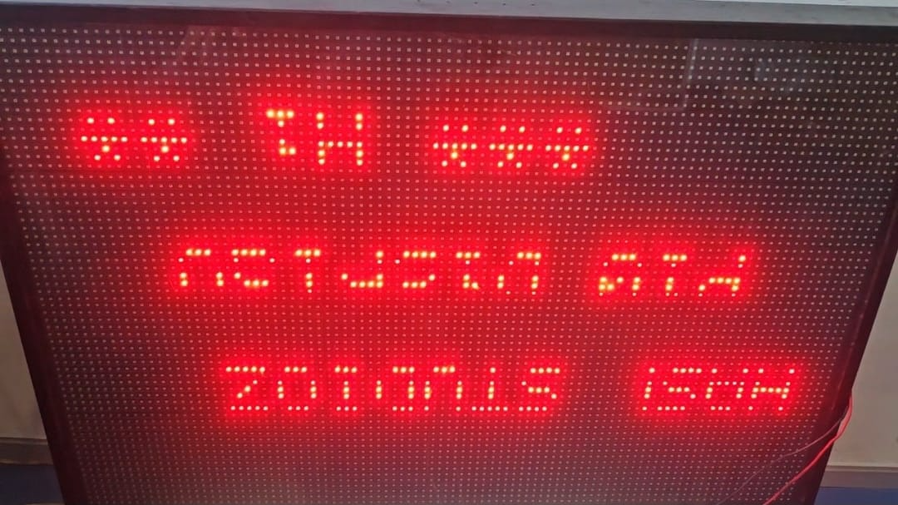
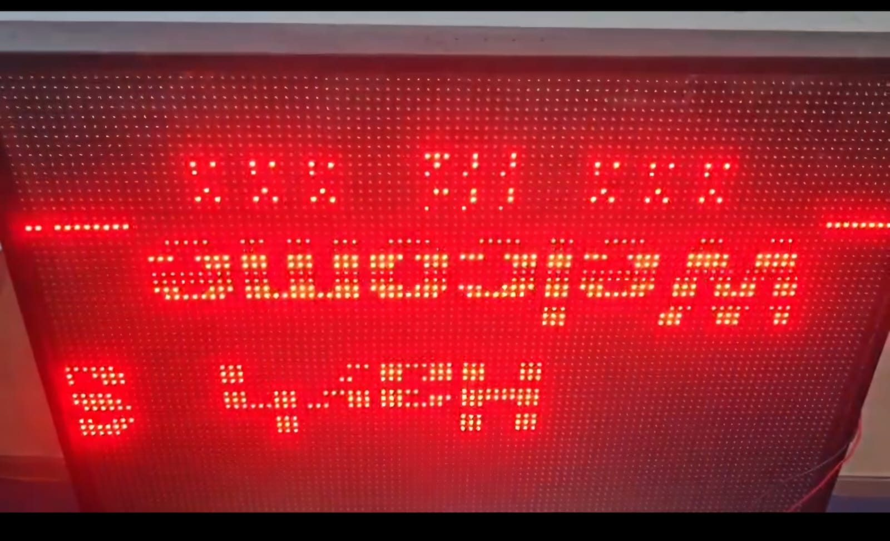

# ESP32 P10 Ethernet LED Display Controller

A documentation-first engineering case study of an ESP32-based P10 LED matrix controller with W5500 wired Ethernet.

> **Confidentiality note:** This repository documents the system at a high level. The production firmware and proprietary implementation are intentionally not included. The original project support files (`platformio.ini`, `default_ota.csv`, and the root placeholder READMEs) are included with permission from the project owner; they provide context and do not make the redacted source buildable. Diagrams and flows are conceptual, not wiring plans or source-code traces.

## Evidence matrix

| Claim | Artifact | What it shows | Public release boundary |
| --- | --- | --- | --- |
| Four-line display with independently populated lines | [`p10-display-line-control.png`](media/p10-display-line-control.png), [Drive evidence archive](https://drive.google.com/drive/folders/1Rl7MxlMSVG_yuMZJBnGRHxVEYuInktFD?usp=sharing) | Photos I took and videos I recorded showing independently populated display lines | Command packets, timing details, and pixel-health records remain outside the public repository |
| Scrolling and changing display content | [Drive evidence archive](https://drive.google.com/drive/folders/1Rl7MxlMSVG_yuMZJBnGRHxVEYuInktFD?usp=sharing) | Demonstration videos I recorded during project testing | Exact scroll algorithm, timing target, and deployment request details remain withheld |
| Font/style variation | [`p10-display-font-style-variation.jpg`](media/p10-display-font-style-variation.jpg), [Drive evidence archive](https://drive.google.com/drive/folders/1Rl7MxlMSVG_yuMZJBnGRHxVEYuInktFD?usp=sharing) | Photos I took showing different text presentation styles | Complete font catalog, rendering performance, and production configuration remain withheld |
| Custom controller PCB with W5500 Ethernet hardware | [Drive evidence archive](https://drive.google.com/drive/folders/1Rl7MxlMSVG_yuMZJBnGRHxVEYuInktFD?usp=sharing) | Hardware photos I took and videos I recorded showing the custom test PCB and attached W5500 hardware | Detailed schematic, electrical review, signal-integrity analysis, and manufacturing records remain private |
| Co-developed and co-debugged embedded system | [Contribution statement](#personal-contributions-and-ownership), [`src/main.cpp`](src/main.cpp), architecture docs, and project history | My account of direct team-based firmware implementation and debugging, with adapted source patterns and engineering context | Complete production implementation, client identity, deployment, and proprietary protocol remain withheld |
| My implementation decision: LAN OTA over SOTA | [`docs/ota-design.md`](docs/ota-design.md), [`docs/design-decisions.md`](docs/design-decisions.md) | I evaluated both OTA approaches and made the decision to select LAN OTA for the W5500-connected controller | Security controls, rollback design, and deployment-specific operations remain withheld |
| OTA validation firmware | [`ota/esp32-p10-ethernet-controller-ota-validation.bin`](ota/esp32-p10-ethernet-controller-ota-validation.bin), [Drive evidence archive](https://drive.google.com/drive/folders/1Rl7MxlMSVG_yuMZJBnGRHxVEYuInktFD?usp=sharing) | The production firmware binary I used to test both SOTA and LAN OTA, with related hardware evidence | This is a validation artifact, not the complete production source or firmware checkout |
| Permission to publish | [Project background](#project-background), [Media publication permission](media/README.md) | The project owner gave permission to publish the permitted project material | Publication permission does not attribute my photos, videos, implementation work, or OTA decision to the owner |

I took the project photos, recorded the videos, and made the LAN OTA implementation
decision. The matrix
separates visual evidence, my contributions, and publication permission while
keeping sensitive implementation and deployment details private.

### Full hardware evidence archive

**[Open the Google Drive hardware evidence archive](https://drive.google.com/drive/folders/1Rl7MxlMSVG_yuMZJBnGRHxVEYuInktFD?usp=sharing)**

The Drive folder is the full archive for the additional hardware photos and
videos. The repository intentionally keeps only selected still images locally;
the local MP4s and video-derived previews were removed. Review the Drive folder
permissions and contents before public sharing, and remove any source-code views,
network settings, credentials, addresses, or other restricted material.

## Project background

I co-developed and co-debugged this ESP32 P10 display controller with the project team during my internship at [HashStudioz Technologies](https://www.hashstudioz.com/). The resulting firmware was delivered into a live client project. The client, deployment environment, and complete production implementation are not identified in this repository.

I took the project photos and recorded the demonstration videos. I also made the
implementation decision to select LAN OTA after evaluating both OTA approaches.
The project owner gave permission to publish the permitted project material;
that permission is separate from authorship of the work and media.

## Overview

The project context brings together display control, wired network commands, persistent configuration, and concurrent embedded work.

| Area | High-level context |
| --- | --- |
| Controller | ESP32 |
| Network interface | W5500 Ethernet controller over SPI |
| Display | Four-line P10 LED matrix with independent per-line control; text positioning, fixed/scrolling content, and per-line updates |
| Commands | TCP communication and JSON-based command processing; command packets were also sent over the serial/UART link during development |
| Configuration | ESP32 Preferences/NVS for supported settings |
| Scheduling | FreeRTOS tasks, synchronization of shared state, and timer-driven refresh |
| Maintenance | I evaluated both SOTA and LAN OTA approaches and selected LAN OTA as the better fit for this Ethernet-connected controller because it used the existing W5500 Ethernet connection and avoided dependence on Wi-Fi connectivity |

The technologies and tools involved in this project include **Embedded C/C++, ESP32, PlatformIO, FreeRTOS, SPI, UART/TTL, W5500 Ethernet, TCP/IP socket programming, JSON-based command processing, ESP32 Preferences/NVS for persistent configuration, the DMD32 P10 LED matrix library, SOTA and LAN-based OTA firmware updates**. The work also involved ESP32 libraries for Ethernet communication, JSON parsing, display control, and firmware updating, along with task synchronization and embedded debugging. The original project support files at the root — `platformio.ini`, `default_ota.csv`, `include/README`, `lib/README`, and `test/README` — are present with permission from the project owner. The sole firmware entry point at `src/main.cpp` remains redacted and intentionally non-buildable.

I retain the complete working project and code files locally on my laptop. This
portfolio repository intentionally publishes the permitted support files, selected
redacted source, documentation, and evidence links rather than the complete
production firmware checkout.

## Review path

For a quick technical review, start with:

1. [Architecture](docs/architecture.md) for the controller boundaries and data flow.
2. [Design decisions](docs/design-decisions.md) for the Ethernet, concurrency, persistence, and OTA rationale.
3. [Redacted source showcase](showcase/README.md) for selected embedded implementation patterns and intentional omissions.
4. [Runnable host-side example](examples/README.md) for a dependency-free four-line state/command test model.
5. [Demonstration media](media/README.md) for display observations captured by me and hardware caveats.

This ordering lets a reviewer understand the system before seeing source-like material, while keeping production deployment details out of the public release.

## Public source showcase

The [`src/main.cpp`](src/main.cpp) entry point is a release-reviewed, intentionally non-buildable redacted source showcase based on the authorized project. It includes selected display rendering, row-state persistence, scrolling, timer-scan boundaries, mutex protection, and FreeRTOS lifecycle patterns. The supporting review documentation remains in [`showcase/`](showcase/), and the source intentionally omits the production TCP implementation, deployment-specific network configuration, operational command schema, and LAN OTA upload implementation.

The showcase contains an explicit compile-time stop so it cannot be mistaken for uploadable firmware. It is not a complete copy of the production project. The runnable public code sample is the independently written host-side example in [`examples/four-line-command-core/`](examples/four-line-command-core/).

## Conceptual data path

1. A client submits a request over the local network to a TCP-facing component.
2. The request is interpreted and validated as a structured command.
3. A supported operation changes display or configuration state.
4. Supported settings may be persisted in Preferences/NVS.
5. Display work renders state, while a timing-sensitive refresh mechanism drives the matrix.

These are design-level relationships, not a claim about an exact execution path. See [architecture](docs/architecture.md), the [conceptual system diagram](diagrams/system-architecture.mmd), the [conceptual firmware flow](diagrams/firmware-flow.mmd), and the [project block diagram / visual overview](media/system-overview.png).

## Project visual overview

The [system overview image](media/system-overview.png) is a high-level block-diagram reference for the controller, Ethernet path, display, and supporting responsibilities. It is intentionally not a wiring plan, protocol specification, or source-code trace.

## Demonstration media

The following media is stored directly in this repository rather than hosted externally. The display photos show the project test setup that I captured; the P10 test board had some non-working pixels, as noted in the [hardware/test note](#hardware-and-test-note).


The following photos were captured by me and provide visual evidence from display states: changing and scrolling text, variation in font/style, and separately populated lines that illustrate line-by-line independent control. The project owner gave permission to include them. They document observed test-display output only; still images do not establish timing or production behavior.





All full demonstration videos and additional hardware evidence are hosted in the
[Google Drive hardware evidence archive](https://drive.google.com/drive/folders/1Rl7MxlMSVG_yuMZJBnGRHxVEYuInktFD?usp=sharing), not in GitHub. The local repository intentionally keeps no videos or video-derived previews. See [media/README.md](media/README.md) for the release-review boundary and local still-image inventory.

## Engineering considerations

- **Display:** Four independently controlled lines, so text layout, fixed versus scrolling content, per-line updates, and refresh timing all require explicit boundaries between state changes and physical scanning. See [hardware](docs/hardware.md) and [concurrency](docs/concurrency.md).
- **Networking:** Receive, validate, and dispatch commands without assuming that input is trustworthy or publishing the production command schema. See [networking](docs/networking.md).
- **Persistence:** Decide which settings belong in nonvolatile storage and how runtime state is restored without presenting an unconfirmed boot order as fact. See [architecture](docs/architecture.md).
- **Concurrent work:** Separate slower network handling from display responsibilities; synchronize shared state and keep interrupt work short. See [concurrency](docs/concurrency.md).
- **OTA selection:** I evaluated both SOTA and LAN OTA approaches and selected LAN OTA as the better fit for this Ethernet-connected controller. LAN OTA used the existing W5500 Ethernet connection, avoided dependence on Wi-Fi connectivity, provided a simpler direct firmware-upload workflow over the local network without a separate wireless setup, and suited an Ethernet-connected installation where reliable wired communication was preferred. Deployment-specific protocol, security, rollback, and operational details remain withheld. See [OTA design](docs/ota-design.md) and the [design decisions](docs/design-decisions.md).

The work covered integration topics across embedded display control, Ethernet communication, structured commands, persistence, task design, and OTA evaluation.

## Display capabilities implemented

The production P10 display controller supported:

- Static text and scrolling text.
- Font selection and size selection.
- X/Y positioning for the start location of text.
- Multiple rows with different messages in separate vertical areas when the panel height supports them.
- Message persistence across restart when the relevant save option is used.
- Text replacement without requiring a full display reset.
- Full-display clearing and row-wise clearing.
- Row-wise panel control and layout selection such as 3×3 and 4×3 when supported by the connected panel arrangement.

These capabilities are described from the delivered project and the implementation
evidence. The complete production command implementation remains outside this
repository.

## Final JSON command examples used during testing

```json
{"cmd":"panel","across":3,"down":3}
```

```json
{"cmd":"erase"}
```

```json
{"cmd":"display","row":0,"message":"HASH STUDIOZ","x":0,"size":0,"save":1}
```

```json
{"cmd":"erase","row":1}
```

```json
{"cmd":"display","row":2,"message":"TEST","x":25,"size":1,"save":0,"scroll":1}
```

These examples document panel-layout selection, full-display erase, row-wise
display, row-wise erase, positioning, font/size selection, persistence choice,
and scrolling. They are project documentation, not a substitute for the
withheld production transport implementation.

## Skills demonstrated

- Embedded C/C++ development for an ESP32-based display controller.
- W5500 Ethernet integration over SPI and separation of transport from command processing.
- JSON command validation and state updates across TCP and a development UART path.
- Four-line display modeling with independent line updates, fixed text, scrolling, and font/style selection.
- Preferences/NVS persistence with explicit separation between runtime state and retained display state.
- FreeRTOS task design, mutex-protected shared state, and timing-sensitive display refresh boundaries.
- Hardware-aware debugging: distinguishing panel/pixel faults from rendering or state-management behavior.
- Firmware-maintenance design, including SOTA and LAN OTA implementation/evaluation, with LAN OTA selected for the W5500-connected installation.

This list describes the engineering areas represented by the delivered project and
the public portfolio release.

## Delivery and production status

The production-ready firmware was delivered to a client project. I retain all
complete working code files locally on my laptop; this public repository contains
the permitted support files, documentation, selected redacted source, and evidence
links rather than the complete production checkout.

I used the production firmware binary to validate both SOTA and LAN OTA workflows.
The validation copy is included at
[`ota/esp32-p10-ethernet-controller-ota-validation.bin`](ota/esp32-p10-ethernet-controller-ota-validation.bin).
It is a generated validation artifact, not the complete production source or
firmware checkout. Supporting hardware and OTA evidence is available in the
[Google Drive archive](https://drive.google.com/drive/folders/1Rl7MxlMSVG_yuMZJBnGRHxVEYuInktFD?usp=sharing).

## Personal contributions and ownership

I co-developed and co-debugged this controller during my internship at HashStudioz Technologies. My work covered display control and rendering behavior for a four-line P10 matrix in which every line is driven independently, the W5500 Ethernet path and structured command handling, persistent configuration, concurrent task design and shared-state synchronization, custom controller PCB integration with the attached W5500 hardware, and development of the LAN OTA update approach. I co-debugged display, Ethernet, concurrency, OTA, and hardware-integration issues with the project team. The firmware was delivered into a live client project.

My role involved direct embedded implementation, integration, and team-based debugging—not only preparing this repository. This statement describes my co-development and co-debugging work without claiming sole authorship of the whole system or sole design ownership of the PCB. Production implementation details, internal protocols, the client's identity, and deployment information are intentionally withheld; this contribution account is my recollection of the work, not an independently audited attribution record.

## Additional evidence archive

[Additional photos and videos — Google Drive evidence archive](https://drive.google.com/drive/folders/1Rl7MxlMSVG_yuMZJBnGRHxVEYuInktFD?usp=sharing)

This is the linked evidence archive. The project owner gave permission to share
it for this release. Keep only sanitized material in the shared folder; the repository-local
still images remain available as the directly inspectable subset.

## Development and test tooling

Manual command testing during development was carried out with [RealTerm](https://realterm.sourceforge.io/), a third-party serial/TCP terminal tool built for sending binary and hard-to-type data streams, using its packet-send feature over the controller's serial/UART link to exercise the controller's command handling. The packet contents, the serial settings, and the adapter used are not published, and manual tooling use is not recorded here as a passed test. See [testing](docs/testing.md) and the [test plan](tests/test-plan.md).

## OTA status

I implemented and evaluated both SOTA and LAN OTA approaches. I selected LAN OTA
as the better fit for this Ethernet-connected controller because it used
the existing W5500 Ethernet connection, avoided dependence on Wi-Fi connectivity,
provided a simpler direct firmware-upload workflow over the local network without
a separate wireless setup, and suited an Ethernet-connected installation where
reliable wired communication was preferred. The implementation and delivery
status are based on my implementation and validation; deployment-specific security and operational details
remain withheld from this public portfolio.

## Hardware and test note

The P10 display board used for testing had some non-working pixels. Consequently, an observed display defect may be hardware-related and is not automatically a firmware defect. Display observations should be interpreted alongside the condition of the test hardware; see [troubleshooting](docs/troubleshooting.md).

## Repository guide

## Repository structure

This repository is organized so a reviewer can understand the project without
mistaking the portfolio files for the complete production checkout:

| Folder/file | What it contains | Why it is included |
| --- | --- | --- |
| `README.md` | Project overview, evidence matrix, contribution statement, display capabilities, JSON examples, OTA decision, and release boundaries | Provides the main project narrative and explains what is public versus withheld |
| `src/` | `src/main.cpp`, a redacted, intentionally non-buildable firmware showcase | Shows selected embedded patterns without publishing the complete production firmware |
| `examples/` | An independently written host-side C++17 four-line display/state example and its local test | Gives reviewers runnable state-management logic without requiring ESP32 hardware |
| `docs/` | Architecture, hardware, networking, concurrency, OTA, testing, troubleshooting, and publication-boundary documentation | Explains the engineering decisions and integration boundaries in a portable format |
| `tests/` | The hardware and production validation matrix | Records the areas tested or evaluated and the deployment details that remain private |
| `showcase/` | A focused explanation of the redacted source and intentionally omitted production sections | Helps reviewers understand why the public firmware file is not a complete build |
| `media/` | Local still images that I captured, plus the media release notes and Google Drive evidence link | Shows the display, custom PCB, and W5500 hardware while keeping the full video archive external |
| `diagrams/` | Editable Mermaid system-architecture and firmware-flow diagrams | Gives a high-level view of data flow and responsibilities; these are conceptual, not wiring plans |
| `ota/` | `esp32-p10-ethernet-controller-ota-validation.bin`, the firmware binary I used to validate SOTA and LAN OTA | Preserves the exact OTA test artifact used in the project; it is not production source and is not a substitute for the complete firmware checkout |
| `platformio.ini` | Approved PlatformIO project configuration included with project-owner permission | Provides build/project context for the portfolio release |
| `default_ota.csv` | OTA partition-layout file included with project-owner permission | Documents the partition context used by the OTA workflow |
| `include/`, `lib/`, `test/` | PlatformIO placeholder README files | Preserve the approved project layout without publishing additional production headers, libraries, or tests |
| `src/P10 display.code-workspace` | Minimal workspace file copied from the original project | Preserves the project’s workspace layout; it contains only a relative root-folder reference and no local absolute paths or credentials |
| `.gitignore` | Rules excluding generated output, secrets, and unapproved artifacts, with one exception for the documented OTA validation binary | Keeps the public repository reproducible and prevents accidental artifact leakage |

The project owner gave permission to publish the permitted material. I took the
photos and recorded the videos, and I made the LAN OTA selection decision. The
complete working project remains local and is not represented by this folder
structure.

| Location | Purpose |
| --- | --- |
| [docs/README.md](docs/README.md) | Public repository layout and exact inclusion/exclusion rules |
| [docs/architecture.md](docs/architecture.md) | Component boundaries and conceptual data flow |
| [docs/hardware.md](docs/hardware.md) | Component roles and electrical integration considerations |
| [docs/networking.md](docs/networking.md) | Generic TCP/JSON processing boundaries |
| [docs/concurrency.md](docs/concurrency.md) | Tasks, shared state, and refresh considerations |
| [docs/ota-design.md](docs/ota-design.md) | LAN OTA flow, delivery status, and deployment boundary |
| [docs/design-decisions.md](docs/design-decisions.md) | High-level decisions, rationale, and disclosure boundaries |
| [docs/troubleshooting.md](docs/troubleshooting.md) | Documentation-first checks for display, network, configuration, and OTA observations |
| [docs/testing.md](docs/testing.md) · [tests/test-plan.md](tests/test-plan.md) | Evidence policy and validation matrix |
| [diagrams/](diagrams/) | Editable, conceptual Mermaid diagrams |
| [showcase/README.md](showcase/README.md) · [src/main.cpp](src/main.cpp) | Redacted, non-buildable source entry point and omission boundary |
| [examples/README.md](examples/README.md) · [media/README.md](media/README.md) | Independent host-side example and captured-media inventory/release boundary |

## Validation and disclosure

The repository distinguishes local checks from hardware/production evidence. The
host-side example and source-boundary guard are supplementary portfolio checks.
The [test plan](tests/test-plan.md) uses graded evidence states: **Media
evidence (captured by me; owner permission granted)** and **Implemented, deployment details withheld**.
Drive evidence supports the project history of production
Ethernet/TCP, TTL/UART development communication, and SOTA/LAN OTA
implementation/evaluation. The production-ready firmware was delivered to a
client project; client identity and sensitive deployment details are withheld.

The complete production source, production network/OTA implementation, sensitive deployment values, `.pio/`, firmware binaries other than the explicitly documented OTA validation artifact, generated build output, local-path IDE files (`.vscode/` and other workspace files), internal network identifiers and endpoints, credentials, logs, and unapproved media are excluded. The minimal `src/P10 display.code-workspace` is the sole workspace-file exception; it contains only a relative root-folder reference. The redacted `src/main.cpp` is the only firmware source in the repository and is intentionally non-buildable. The original project support files — `platformio.ini`, `default_ota.csv`, `include/README`, `lib/README`, and `test/README` — are included with permission from the project owner; they are context files, not a production build. See the [public repository layout and release boundary](docs/README.md) and [showcase README](showcase/README.md) for exact inclusion and omission rules. Any future public detail or attribution requires permission review. Licensing remains unspecified pending authorization.

For questions about this overview, contact me through my GITHUB.
