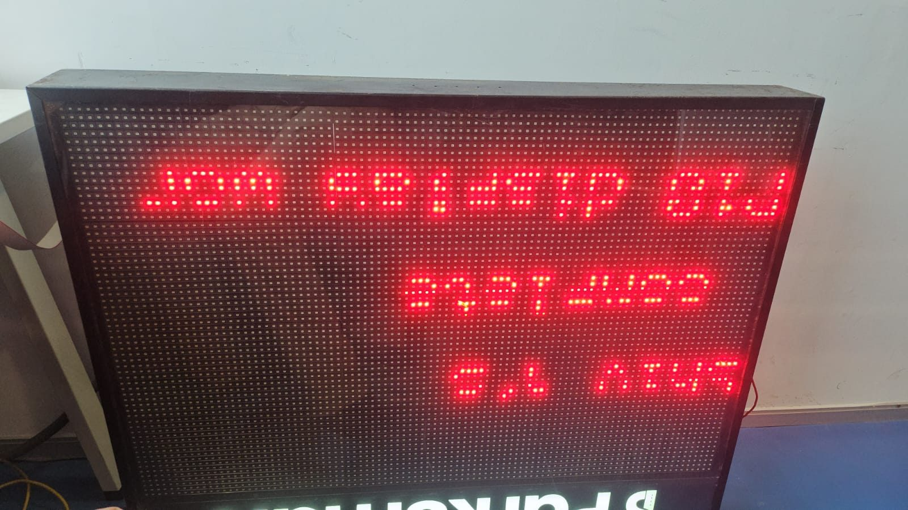
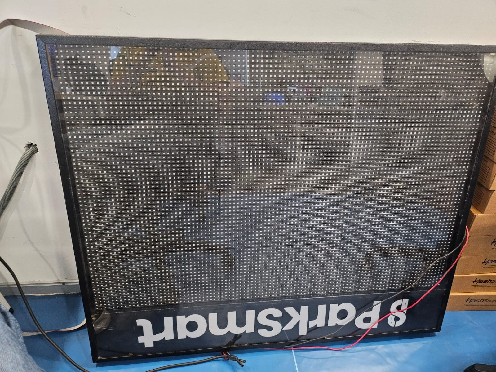

# ESP32 P10 Ethernet LED Display Controller

A documentation-first engineering case study of an ESP32-based P10 LED matrix controller with W5500 wired Ethernet.

> **Confidentiality note:** This repository documents the system at a high level. The production firmware and proprietary implementation are intentionally not included. Diagrams and flows are conceptual, not wiring plans or source-code traces.

## Project background

This controller's embedded firmware was developed during an internship at [HashStudioz Technologies](https://www.hashstudioz.com/), a product-engineering and IoT company, and the resulting firmware was delivered into a live client project. The client, the deployment environment, and the production implementation are not identified in this repository.

## Overview

The project context brings together display control, wired network commands, persistent configuration, and concurrent embedded work. This portfolio describes the engineering boundaries and validation questions without distributing production code, configuration, protocols, or evidence that has not been approved for release.

| Area | High-level context |
| --- | --- |
| Controller | ESP32 |
| Network interface | W5500 Ethernet controller over SPI |
| Display | Four-line P10 LED matrix with independent per-line control; text positioning, fixed/scrolling content, and per-line updates |
| Commands | TCP communication and JSON-based command processing |
| Configuration | ESP32 Preferences/NVS for supported settings |
| Scheduling | FreeRTOS tasks, synchronization of shared state, and timer-driven refresh |
| Maintenance | The project owner reports that both SOTA and LAN OTA approaches were implemented and evaluated; LAN OTA was selected as the better fit for this Ethernet-connected controller |

The technologies discussed for this work include embedded C/C++, PlatformIO, FreeRTOS, SPI, TCP/IP, JSON, and the ESP32 update APIs. No runnable firmware or build configuration is supplied here.

## Conceptual data path

1. A client submits a request over the local network to a TCP-facing component.
2. The request is interpreted and validated as a structured command.
3. A supported operation changes display or configuration state.
4. Supported settings may be persisted in Preferences/NVS.
5. Display work renders state, while a timing-sensitive refresh mechanism drives the matrix.

These are design-level relationships, not a claim about an exact execution path. See [architecture](docs/architecture.md), the [conceptual system diagram](diagrams/system-architecture.mmd), the [conceptual firmware flow](diagrams/firmware-flow.mmd), and the [project block diagram / visual overview](media/system-overview.png).

## Project visual overview

The [system overview image](media/system-overview.png) is a high-level block-diagram reference for the controller, Ethernet path, display, and supporting responsibilities. It is intentionally not a wiring plan, protocol specification, or source-code trace.

## Demonstration media

The following media is stored directly in this repository rather than hosted externally. The display photos show the supplied test setup; the P10 test board had some non-working pixels, as noted in the [hardware/test note](#hardware-and-test-note).

The demonstration clips are silent H.264 MP4 files (no audio track). GitHub's Markdown sanitizer removes inline `<video>` elements, so the clips are linked instead of embedded; each link opens in GitHub's built-in player.

| Clip | Length | Size |
| --- | --- | --- |
| [Display demonstration 1](media/display-demo-1.mp4) | 76 s | ~14 MB |
| [Display demonstration 2](media/display-demo-2.mp4) | 125 s | ~17 MB |
| [Display demonstration 3](media/display-demo-3.mp4) | 6 s | ~1 MB |

See [media/README.md](media/README.md) for the release-review boundary and the complete local media inventory.

## Engineering considerations

- **Display:** Four independently controlled lines, so text layout, fixed versus scrolling content, per-line updates, and refresh timing all require explicit boundaries between state changes and physical scanning. See [hardware](docs/hardware.md) and [concurrency](docs/concurrency.md).
- **Networking:** Receive, validate, and dispatch commands without assuming that input is trustworthy or publishing the production command schema. See [networking](docs/networking.md).
- **Persistence:** Decide which settings belong in nonvolatile storage and how runtime state is restored without presenting an unconfirmed boot order as fact. See [architecture](docs/architecture.md).
- **Concurrent work:** Separate slower network handling from display responsibilities; synchronize shared state and keep interrupt work short. See [concurrency](docs/concurrency.md).
- **OTA selection:** The project owner reports that both SOTA and LAN OTA approaches were implemented and evaluated, with LAN OTA selected as the better fit for this Ethernet-connected controller. This repository does not claim a particular protocol, security model, deployment process, rollback behavior, or production readiness. See [OTA design](docs/ota-design.md) and the [design decisions](docs/design-decisions.md).

The work covered integration topics across embedded display control, Ethernet communication, structured commands, persistence, task design, and OTA evaluation.

## Personal contributions and ownership

My contribution was the embedded firmware work on this controller during the internship at HashStudioz Technologies, covering display control and rendering behavior for a four-line P10 matrix in which every line is driven independently, the W5500 Ethernet path and structured command handling, persistent configuration, concurrent task design and shared-state synchronization, and development of the LAN OTA update approach. The firmware was delivered into a live client project.

This section describes my own contribution and does not claim sole authorship of the whole system. Production implementation details, internal protocols, the client's identity, and deployment information are intentionally withheld, and the summary above is written from my own recollection of the work rather than from a released specification.

## Development and test tooling

Manual command testing during development was carried out with [RealTerm](https://realterm.sourceforge.io/), a third-party serial/TCP terminal tool built for sending binary and hard-to-type data streams, using its packet-send feature to exercise the controller's command handling. The packet contents and the connection settings are not published, and manual tooling use is not recorded here as a passed test. See [testing](docs/testing.md) and the [test plan](tests/test-plan.md).

## OTA status

Per the project owner, both SOTA and LAN OTA approaches were implemented and evaluated. LAN OTA was selected as the better fit for this Ethernet-connected controller. The repository records that decision at a high level only: it does not establish the exact OTA protocol, security controls, operational workflow, rollback behavior, or end-to-end production readiness. Any release claim requires owner confirmation and approved evidence.

## Hardware and test note

The P10 display board used for testing had some non-working pixels. Consequently, an observed display defect may be hardware-related and is not automatically a firmware defect. Display observations should be interpreted alongside the condition of the test hardware; see [troubleshooting](docs/troubleshooting.md).

## Repository guide

| Location | Purpose |
| --- | --- |
| [docs/architecture.md](docs/architecture.md) | Component boundaries and conceptual data flow |
| [docs/hardware.md](docs/hardware.md) | Component roles and electrical integration considerations |
| [docs/networking.md](docs/networking.md) | Generic TCP/JSON processing boundaries |
| [docs/concurrency.md](docs/concurrency.md) | Tasks, shared state, and refresh considerations |
| [docs/ota-design.md](docs/ota-design.md) | Proposed OTA flow and open validation questions |
| [docs/design-decisions.md](docs/design-decisions.md) | High-level decisions, rationale, and disclosure boundaries |
| [docs/troubleshooting.md](docs/troubleshooting.md) | Documentation-first checks for display, network, configuration, and OTA observations |
| [docs/testing.md](docs/testing.md) · [tests/test-plan.md](tests/test-plan.md) | Evidence policy and unverified test matrix |
| [diagrams/](diagrams/) | Editable, conceptual Mermaid diagrams |
| [examples/README.md](examples/README.md) · [media/README.md](media/README.md) | Boundaries for future independently written examples and approved media |

## Validation and disclosure

All tests in the [test plan](tests/test-plan.md) are **Needs confirmation**, and this repository publishes no test results. The firmware was delivered into a client project, but delivery is not evidence of any specific behavior: it does not demonstrate a successful OTA upload, reboot, recovery path, or security control. Read these statuses as "no verified evidence is published in this repository" rather than as a statement that a feature was never implemented. The owner-reported OTA implementation and evaluation are recorded as project history, not as independent evidence of end-to-end production readiness.

Production source, `platformio.ini`, firmware binaries, internal network identifiers and endpoints, credentials, logs, and unapproved media are excluded. Any future public detail or attribution requires an owner review for disclosure permission. Licensing remains unspecified pending authorization.

For questions about this overview, contact the repository owner through their professional profile.
