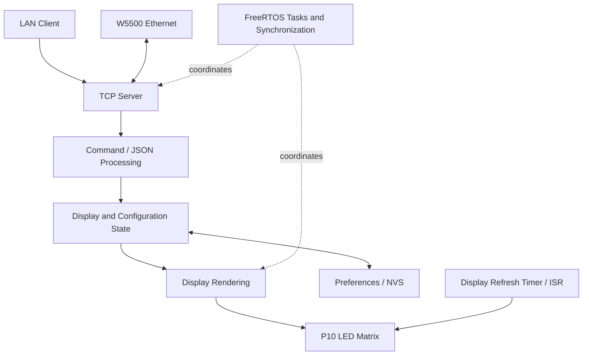

# Architecture (conceptual)

> This is a public, high-level model of responsibilities, not the production implementation, an exact boot sequence, or a wiring schematic.

The ESP32 is the central controller. A W5500 interface provides wired Ethernet and communicates with the controller over SPI. At the software boundary, a TCP-facing component receives requests; JSON interpretation and validation map supported requests to operations on display or configuration state. Rendered state is presented on a four-line P10 LED matrix in which every line is driven independently. ESP32 Preferences/NVS can retain supported settings across restarts. This description deliberately omits protocol fields, pin assignments, and implementation details.

[Editable Mermaid source](../diagrams/system-architecture.mmd) · [Conceptual firmware flow](../diagrams/firmware-flow.mmd)

## Responsibility boundaries

| Boundary | Design consideration |
| --- | --- |
| Wired interface → request handling | SPI connects the ESP32 and W5500; TCP supplies a transport, not a trusted command. |
| Request handling → state | Validate structure and supported operations before updating state; see [networking](networking.md). |
| State → persistence | Persist only settings intended to survive a restart; treat temporary display state separately. |
| State → display | Coordinate readers and writers so rendering observes consistent state; a per-line update must not disturb the other lines. See [concurrency](concurrency.md). |
| Rendering → physical refresh | Keep timing-sensitive timer/interrupt work short and avoid network processing in that path. |

FreeRTOS tasks provide a way to separate network and display responsibilities; shared mutable state calls for synchronization rather than relying on task/core placement. The diagram expresses coordination, not a particular task count, core assignment, scheduling policy, bus topology for the display, or code-level call graph.
