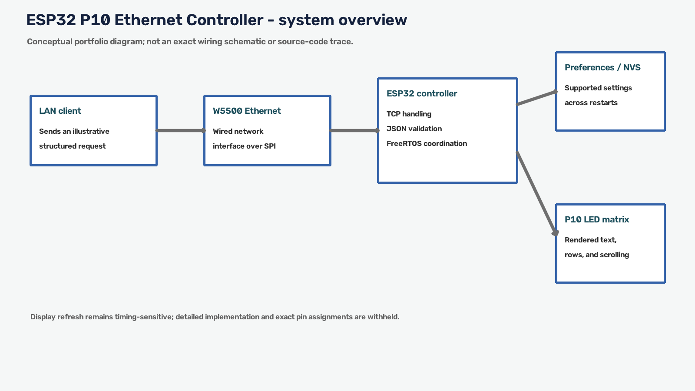

# Project media and publication permission

The media documents the P10 display and controller setup, permitted branding, and
the custom controller PCB used with the attached W5500 hardware. I took the
project photos and recorded the videos, including those in the linked archive.
The project owner gave permission to include the media in
this portfolio release.

> **Release status:** the project owner gave permission to include the
> demonstration media. Inclusion permission is not a substitute for redaction:
> laptop screens, written network settings, and source-code views still require
> a privacy review. No permission date is inferred from recording filenames.

The local inventory includes the visual overview and display photos captured by
me. Full videos and additional hardware evidence are hosted in the Google Drive
archive below. Captions remain high level and do not identify deployment details,
network identifiers, credentials, or production implementation. The selected
local still images can be viewed without accessing the external archive.

The [system overview image](system-overview.png) is the visual-overview
reference used by the main README. The editable [conceptual architecture
diagram](../diagrams/system-architecture.mmd) remains a text-based illustration
for documentation purposes.

## Visual overview

| File | Purpose |
| --- | --- |
| [system-overview.png](system-overview.png) | High-level system visual used by the main README; not a wiring plan or source trace. |

## Photos captured by me

| File | Caption |
| --- | --- |
| [display-live-test.jpg](display-live-test.jpg) | Display showing test content. |
| [display-test-panel.jpg](display-test-panel.jpg) | P10 display test board. The board had some non-working pixels during testing. |
| [p10-display-line-control.png](p10-display-line-control.png) | P10 display with changing text and independently populated lines. |
| [p10-display-font-style-variation.jpg](p10-display-font-style-variation.jpg) | P10 display showing font and style variation across lines. |

These still images document captured test-display states associated with
changing or scrolling text, font/style variation, and line-by-line independent
control. They do not establish timing, complete pixel health, network behavior,
or production behavior. The non-working pixels on the P10 test board are a
hardware caveat when interpreting any visible defect.

The custom controller PCB visible in the footage I recorded is included as
hardware-integration evidence: it shows the test hardware used with the W5500
Ethernet controller. It is not a schematic, manufacturing release, or electrical
qualification record.

## Full hardware evidence archive

[Additional photos and videos — Google Drive evidence archive](https://drive.google.com/drive/folders/1Rl7MxlMSVG_yuMZJBnGRHxVEYuInktFD?usp=sharing)

The project owner gave permission to share this folder for the release. Keep
source-code views, credentials, addresses, operational
endpoints, and other restricted content out of the shared folder. The local MP4s
and video-derived previews were removed from this repository; the local still
images remain the directly inspectable subset.

## Command and display evidence

The Google Drive archive contains the broader command-validation and hardware
evidence. The public repository keeps the command examples and selected display
states while deployment identifiers, terminal settings, and proprietary captures
remain withheld.

## Drive-archive privacy review

The Drive archive may contain laptop views of source code, network/tooling
screens, or written notes. Keep sensitive regions out of the public folder and
retain only release-permitted files. The repository-local videos and derived
previews were removed; the Drive folder contains the additional evidence archive.

## Review checklist for future media

Review each photo and video for visible addresses, MACs, serial numbers,
customer/company names or branding beyond what is permitted, credentials,
proprietary UI/data, and other identifying details. Do not reuse company-site
images or internal screenshots without approval. Keep descriptions high level
and do not infer implementation details from the footage. The repository's media
and diagrams are portfolio evidence, while production network/OTA implementation,
sensitive deployment values, binaries, generated build output, and local-path IDE
files remain omitted from the public release.
